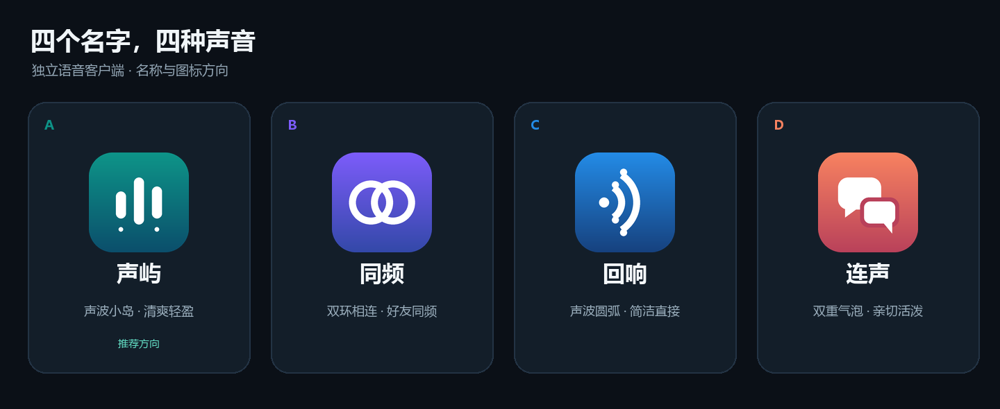

# 回响：名称与图标

已根据用户选择将应用名称改为“回响”。图标选择用户所附图案中的紫色独眼小怪兽，使用内置 imagegen 编辑模式提取、适配为透明角色素材。原附件保留；生成原文件也保留在工具默认目录，项目使用本目录的副本。

- 透明源图：[huixiang-mascot.png](huixiang-mascot.png)。
- 完整制作提示词：[huixiang-imagegen-prompt.txt](huixiang-imagegen-prompt.txt)。
- Android 资源：`app/src/main/res/drawable-nodpi/huixiang_mascot.webp`。采用无损格式转换，逐字节核对解码后的 RGBA 像素一致；未裁切、调色或移除已有透明度。
- PNG 771,583 字节；应用 WebP 502,776 字节。桌面图标使用深紫底色与相对留白，启动页/应用标题直接使用角色资源；系统主题与通知另用简化的单色独眼角色矢量图。
- 使用分数留白，使图标随边界缩放；参考 [Android InsetDrawable 文档](https://developer.android.com/reference/android/graphics/drawable/InsetDrawable)。
- 名称已更新到各语言资源、应用内标题与新登录设备名称。保留应用标识及存储标识，以继续覆盖更新已有安装和读取本机数据。
- 已纳入 0.3.5 精简安装包。首页及圆角、圆形、主题单色和通知图标已通过 Robolectric 渲染并人工查看；实际手机桌面效果仍需设备验收。预览见 `../screenshots/huixiang-entry-zh.png` 和 `../screenshots/app-icon.png`，完整结果见 [验收记录](../VALIDATION.md)。

## 之前的候选方案

| 方案 | 名称 | 图标 | 颜色 |
| --- | --- | --- | --- |
| A | 声屿 | 三段声波与小岛光点 | 青绿 |
| B | 同频 | 相连双环 | 紫蓝 |
| C | 回响 | 发声点与回声圆弧 | 蓝色 |
| D | 连声 | 相连对话气泡 | 珊瑚色 |

这些候选 SVG 作为设计过程的参考保留，已选择的图标是上面的紫色独眼角色。
